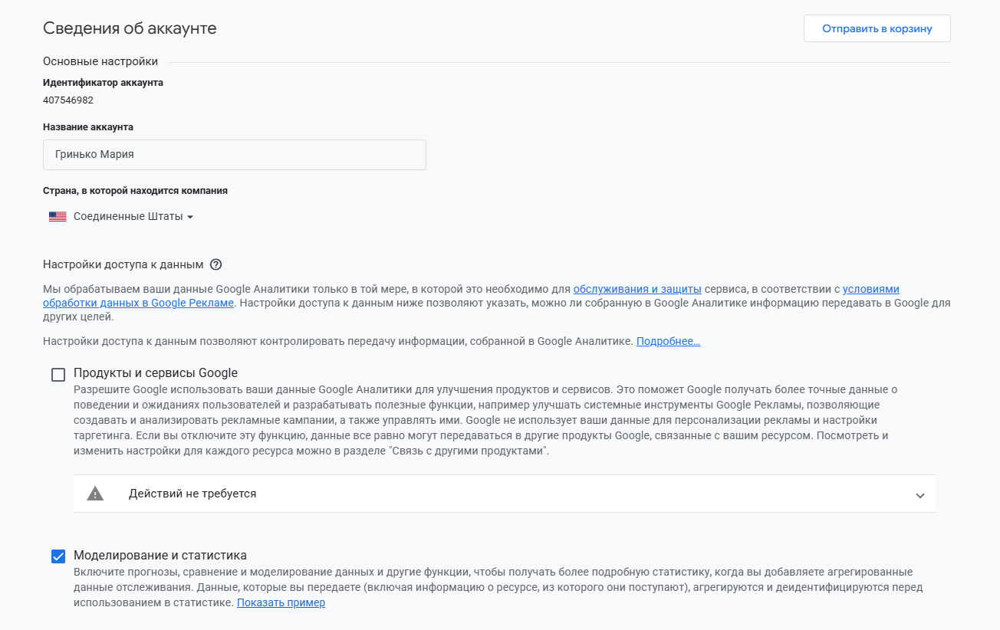
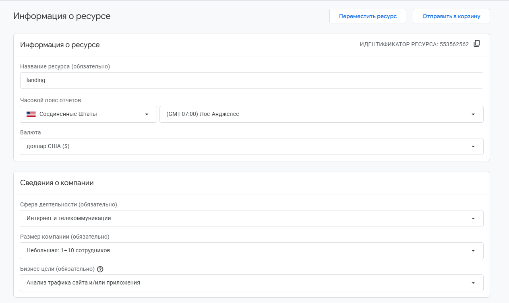
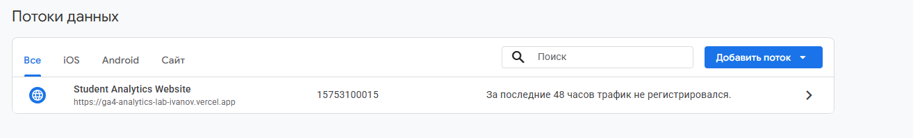
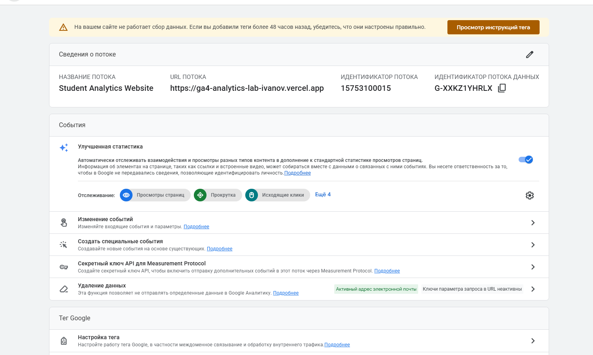

# Домашняя работа № 2 · Где бизнес теряет клиентов

**Дисциплина:** ОП.03 «Информационные технологии»

| Поле | Значение |
|---|---|
| Фамилия, имя, отчество | Гринько Мария |
| Группа | РПО-3 2025 |
| Номер работы | 2 |
| Тема работы | Анализ воронки цифрового продукта и структура Google Analytics 4 |
| Дата сдачи | 30.10.2026 |

---

# Часть 1. Исследование воронки

## 1.1. Объект исследования

| Поле | Значение |
|---|---|
| Компания, сервис или отрасль | Учебный стенд «GA4 Lab» (лабораторный сайт) |
| Адрес сайта или приложения | https://ga4-analytics-lab-ivanov.vercel.app/ |
| Целевое действие | Отправка учебной формы (событие `generate_lead`) |
| Почему выбран этот объект | Это учебный проект, на котором мы отрабатываем навыки веб-аналитики. Исследование поможет понять, как пользователи проходят путь до отправки формы. |

## 1.2. Воронка

| № | Этап | Что считается переходом дальше | Метрика этапа |
|---|---|---|---|
| 1 | Переход на главную страницу | Открытие сайта | `page_view` |
| 2 | Просмотр контента | Прокрутка страницы вниз | `scroll` |
| 3 | Клик по кнопке | Нажатие на кнопку «Записаться» | `cta_click` |
| 4 | Начало заполнения формы | Клик в любое поле формы | `form_start` |
| 5 | Отправка заявки | Нажатие кнопки «Отправить» | `generate_lead` |

## 1.3. Источники

### Источник 1
| Поле | Значение |
|---|---|
| Название материала | «Как увеличить конверсию сайта: 20 способов» |
| Автор или организация | Яндекс.Практикум |
| Дата публикации | 2024 |
| Прямая ссылка | https://practicum.yandex.ru/blog/kak-uvelichit-konversiyu-sajta/ |

**Выписка из материала:**
> «Даже если сайт красивый и удобный, пользователи могут уходить, если не понимают, что им предлагают. Кнопка призыва к действию (CTA) должна быть на видном месте».

**Что подтверждает и как связано с моей воронкой:**
> Это подтверждает, что этап 3 (клик по кнопке) критичен. Если пользователь не видит кнопку «Записаться», он уйдет.

**Цифры из источника и этап воронки:**
> Правильно настроенная кнопка CTA повышает конверсию на 10-20%. (Этап 3).

### Источник 2
| Поле | Значение |
|---|---|
| Название материала | «Почему пользователи бросают корзину» |
| Автор или организация | Tinkoff Data |
| Дата публикации | 2023 |
| Прямая ссылка | https://www.tinkoff.ru/data/ |

**Выписка из материала:**
> «Длинные формы и запрос лишних данных — главные причины, по которым пользователи не завершают оформление заказа».

**Что подтверждает и как связано с моей воронкой:**
> На этапе 4 (начало заполнения формы) мы теряем клиентов, если просим слишком много данных.

**Цифры из источника и этап воронки:**
> Около 60% пользователей бросают заполнение формы, если она кажется им сложной (Этап 4-5).

## 1.4. Реальные кейсы

### Кейс 1
| № | Пункт | Ответ |
|---|---|---|
| 1 | Компания, продукт или рынок | «Кухня на районе» (доставка еды) |
| 2 | Как выглядела воронка | Реклама в соцсетях → сайт → выбор блюд → корзина → ввод адреса → оплата |
| 3 | В чём заключалась проблема | Пользователи добавляли товары в корзину, но бросали оформление на этапе ввода адреса из-за долгой загрузки карт. |
| 4 | Какие данные подтвердили | Аналитика показывала высокий процент `add_to_cart` и низкий `purchase`. |
| 5 | Что изменили | Сделали ввод адреса короче (автоподсказки). |
| 6 | Как изменился результат | Конверсия в заказ выросла. Точные показатели в открытом источнике не приведены. |
| 7 | Переносим ли подход | Да, нужно упростить форму записи (убрать лишние поля). |

**Ссылка на источник кейса:**
> https://vk.com/business

### Кейс 2
| № | Пункт | Ответ |
|---|---|---|
| 1 | Компания | «Ситилинк» (электроника) |
| 2 | Как выглядела воронка | Переход на карточку товара → добавление в корзину → оформление → вызов курьера |
| 3 | В чём проблема | Высокий процент отказов на этапе оформления (брошенная корзина). |
| 4 | Данные | Метрики Google Analytics показывали, что 70% пользователей доходят до корзины, но не покупают. |
| 5 | Что изменили | Добавили возможность оформить заказ в один клик. |
| 6 | Результат | Конверсия выросла. Точные показатели в открытом источнике не приведены. |
| 7 | Переносим ли подход | Да, можно добавить кнопку «Быстрая запись» на главную страницу. |

**Ссылка на источник кейса:**
> https://www.citilink.ru/

## 1.5. Причины потери пользователей

| № | Этап воронки | Причина потери | Какой источник это подтверждает |
|---|---|---|---|
| 1 | Этап 1 (Главная) | Слишком много информации, пользователь не понимает, куда нажать | Источник 1 (Яндекс.Практикум) |
| 2 | Этап 4 (Форма) | Слишком длинная форма или непонятные поля | Источник 2 (Tinkoff Data) |
| 3 | Этап 5 (Отправка) | Ошибка сервера или долгая загрузка | Кейс 1 («Кухня на районе») |

## 1.6. Гипотезы улучшения

| № | Этап | Гипотеза | Какие данные нужно собрать | Как проверить, сработало |
|---|---|---|---|---|
| 1 | Этап 3 | Если сделать кнопку «Записаться» ярче, конверсия вырастет. | Клики по кнопке | A/B тест (сравнить до и после) |
| 2 | Этап 4 | Если убрать поле Email из формы, больше людей её отправят. | Событие `form_start` и `generate_lead` | Сравнить число заявок |
| 3 | Этап 5 | Если после отправки появляется сообщение «Спасибо», а не перезагрузка страницы, люди чаще доходят до конца. | Глубина скролла, события | Замерить конверсию |

---

# Часть 2. Google Analytics 4

## 2.1. Пройденные шаги

| № | Шаг | Выполнено |
|---|---|---|
| 1 | Вход в Google Analytics под своим аккаунтом | да |
| 2 | Создан Analytics Account | да |
| 3 | Создан Property | да |
| 4 | Выбраны часовой пояс, валюта и общие сведения | да |
| 5 | Выбраны бизнес-цели | да |
| 6 | Создан ресурс | да |
| 7 | Создан Web Data Stream | да |
| 8 | Проверены Website URL, Stream name, Enhanced Measurement | да |
| 9 | Поток создан | да |
| 10 | Найден Measurement ID | да |

## 2.2. Что получилось

| Поле | Значение |
|---|---|
| Analytics Account | Гринько Мария |
| Property | landing |
| Reporting time zone | (GMT-07:00) Лос-Анджелес |
| Currency | доллар США ($) |
| Выбранные бизнес-цели | Анализ трафика сайта и/или приложения |
| Stream name | Student Analytics Website |
| Website URL | https://ga4-analytics-lab-ivanov.vercel.app/ |
| Stream ID (числовой) | 15753100015 |
| Measurement ID (`G-…`) | G-XXKZ1YHRLX |
| Enhanced Measurement | включено |

## 2.3. Скриншоты

*   
*   
*   
*   
*(Скриншот бизнес-целей не приложен отдельно, так как они видны на скриншоте ресурса).*

---

## Использование ИИ

| Вопрос | Ответ |
|---|---|
| Что сделано самостоятельно | Выбрал объект, построил воронку, нашел источники, заполнил таблицы. |
| Что спрошено у модели | Как сформулировать гипотезы. |
| Что после этого проверено и изменено | Адаптировал под свой учебный стенд. |