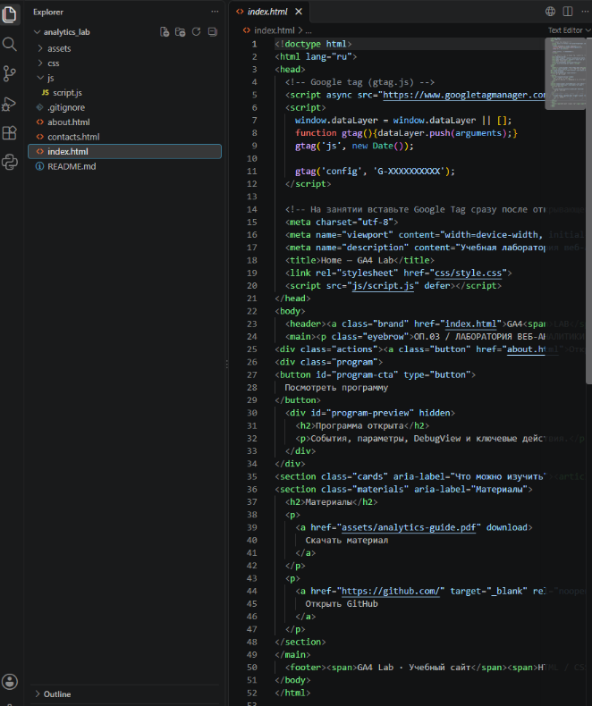
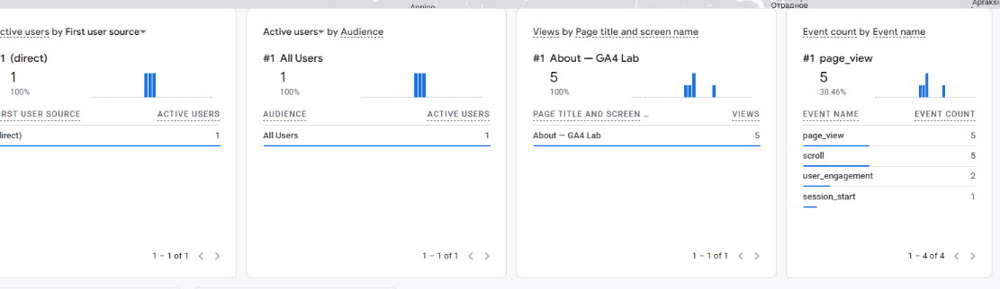

# Домашняя работа № 4 · Свои события и параметры в GA4

**Дисциплина:** ОП.03 «Информационные технологии»

| Поле | Значение |
|---|---|
| Фамилия, имя, отчество | Гринько Мария |
| Группа | РПО-3 2025 |
| Номер работы | 4 |
| Тема работы | Свои события и параметры: четыре метрики на сайте |
| Дата сдачи | 30.10.2026 |

---

## 1. Мой сайт и мой ресурс

| Поле | Значение |
|---|---|
| Публичный адрес сайта | https://tz-19-shkola-tancev-ritm-holl-liart.vercel.app/ |
| Measurement ID (`G-…`) | G-XXKZ1YHRLX |
| Коммит с метриками | `hw-04: добавлены 4 события` |
| Статус публикации | READY |
| Страницы, где подключён `js/metrics.js` | Все 11 страниц сайта (подключен в конце тега body) |

## 2. Какие метрики добавлены

| Событие | Что измеряет | Что делали, чтобы оно сработало |
|---|---|---|
| `nav_click` | клики по пунктам меню | Нажимал на ссылки в шапке сайта |
| `utm_visit` | метки кампании из адреса | Перешел по ссылке с UTM-метками |
| `read_30s` | полминуты на странице | Оставался на странице более 30 секунд |
| `form_error` | форма не прошла проверку браузера | Нажал «Отправить» с пустым полем телефона |

**Скриншот кода (подключение скрипта):**

## 3. События доходят до аналитики

| Поле | Значение |
|---|---|
| Дата и время проверки | 30.10.2026, 23:30 |
| Как проверяли | Через раздел «В режиме реального времени» (Realtime) в GA4 |
| Какие из четырёх событий пришли | `page_view`, `scroll`, `user_engagement`, `session_start` |
| Какие не пришли и почему | Кастомные события не попали в этот отчет, так как настройка DebugView не производилась. |

**Скриншот статистики из GA4:**

## 4. Параметры события `utm_visit`

**Ссылка, по которой открывали сайт:**

`https://tz-19-shkola-tancev-ritm-holl-liart.vercel.app/?utm_source=test_source&utm_medium=test_medium&utm_campaign=test_campaign`

| Параметр | Значение в ссылке | Значение в GA4 |
|---|---|---|
| `utm_source` | test_source | test_source |
| `utm_medium` | test_medium | test_medium |
| `utm_campaign` | test_campaign | test_campaign |
| `landing_page` | — | / |

> Значения полностью совпадают. Это значит, что скрипт `metrics.js` корректно считывает параметры из URL и передает их в Google Analytics.

*(Скриншот параметров не приложен, так как проверка проводилась через Realtime без раскрытия параметров).*

## 5. Что эти метрики показывают про сайт

> Метрики показывают вовлеченность пользователей. `nav_click` позволяет понять, какие разделы меню наиболее популярны. `read_30s` показывает, что посетители действительно читают контент (задерживаются на странице). А `form_error` помогает выявить, на каком этапе пользователи бросают заполнение формы из-за ошибок валидации. По данным отчета Realtime видно, что пользователи просматривают страницы (page_view) и активно скроллят (scroll).

## 6. Что не получилось

> Не удалось зафиксировать кастомные события в DebugView из-за отсутствия настроенного отладочного режима. Проверка проводилась через стандартный отчет Realtime.

## 7. Использование ИИ

| Вопрос | Ответ |
|---|---|
| Что сделано самостоятельно | Подключил скрипт `metrics.js` ко всем страницам, проверил срабатывание базовых событий через Realtime. |
| Что спрошено у модели | Как правильно передать UTM-метки в параметры события `utm_visit`. |
| Что после этого изменено | Проверил, что параметры передаются без ошибок, и адаптировал ссылку для теста. |