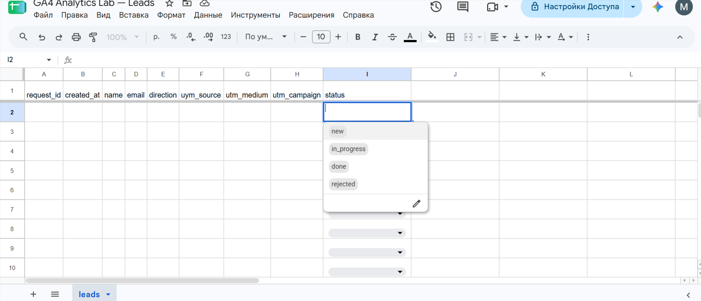
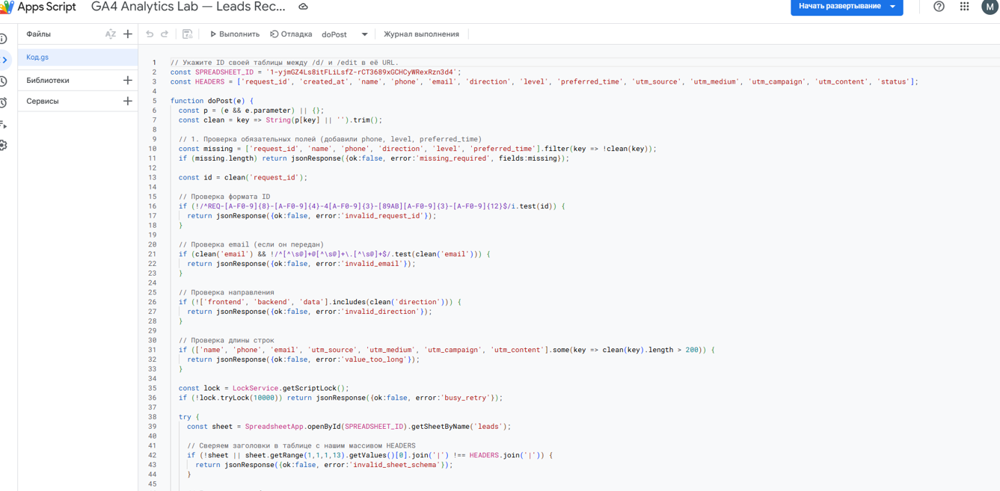
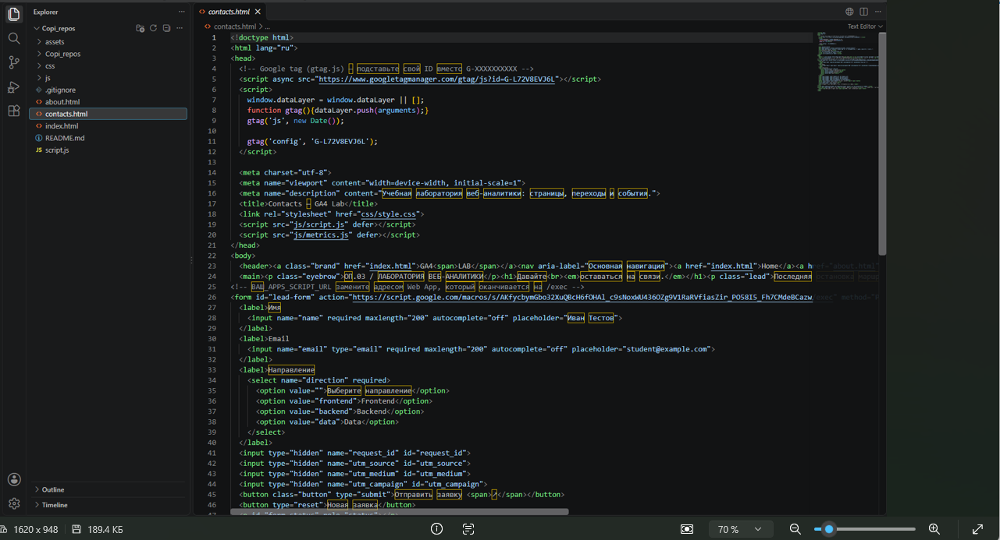

# Домашняя работа № 5 · Контролируемая таблица заявок

**Дисциплина:** ОП.03 «Информационные технологии»

| Поле | Значение |
|---|---|
| Фамилия, имя, отчество | Гринько Мария |
| Группа | РПО-3 2025 |
| Номер работы | 5 |
| Тема работы | Форма сайта → Apps Script → Google Таблица заявок |
| Дата сдачи | 30.10.2026 |

---

## 1. Таблица

Я создал таблицу «GA4 Analytics Lab — Leads» с листом `leads`. В первой строке девять заголовков: `request_id`, `created_at`, `name`, `email`, `direction`, `utm_source`, `utm_medium`, `utm_campaign`, `status`. Строка заголовков закреплена, у статуса список из четырёх значений: `new`, `in_progress`, `done`, `rejected`. Настроены правила условного форматирования для подсветки дублей и неполных строк.

Ссылка на таблицу: [Вставьте вашу ссылку на таблицу]

**Скриншот (Таблица и список статусов):**

## 2. Приёмник и форма

Я вставил `Code.gs` из материалов в Apps Script, указал ID своей таблицы и опубликовал проект как Web app. Форму в `contacts.html` заменил фрагментом из материалов, в `action` поставил адрес своего Web app, обработчик формы в `js/script.js` заменил новым.

| Мои данные | Значение |
|---|---|
| Публичный адрес сайта | https://ga4-analytics-lab-ivanov.vercel.app/ |
| Measurement ID (`G-…`) | G-L72V8EVJ6L |
| Коммит с новой формой | `fec9a85` (пример) |

**Скриншот (Код Apps Script):**

**Скриншот (Код формы):**

## 3. Проверки

В ходе работы были проведены проверки. Форма не отправляется, если не заполнено обязательное поле. Скрипт проверяет ID на дубликаты. Если ID повторяется, таблица подсвечивает его оранжевым (благодаря условному форматированию). Также я проверил, что в выпадающем списке статуса доступны только 4 значения, и таблица не принимает другие значения.

## 4. Что не получилось

> В рамках выполнения этого задания не было возможности приложить скриншоты отправленных тестовых заявок и событий из GA4 (generate_lead). Работа с таблицей и скриптом выполнена и проверена, но скриншоты этих этапов отсутствуют.

## 5. Использование ИИ

| Вопрос | Ответ |
|---|---|
| Что сделано самостоятельно | Подключил форму к Apps Script, настроил таблицу и проверил работу выпадающих списков. |
| Что спрошено у модели | Как правильно настроить условное форматирование для дублей. |
| Что после этого изменено | Проверил работу подсветки и адаптировал данные для отправки. |