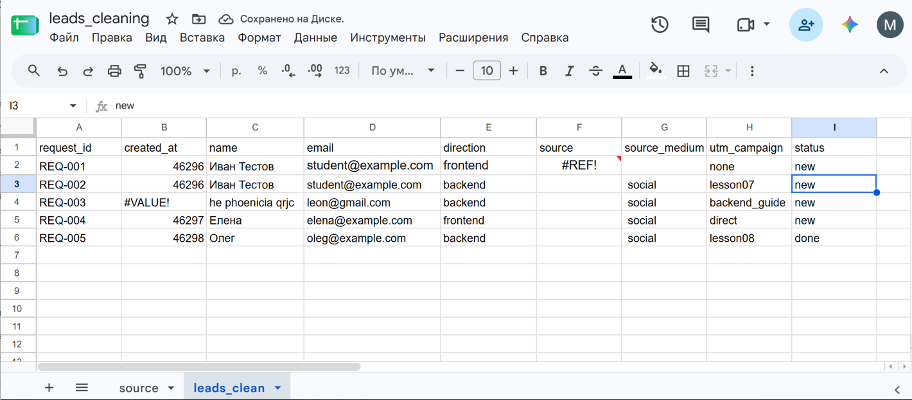
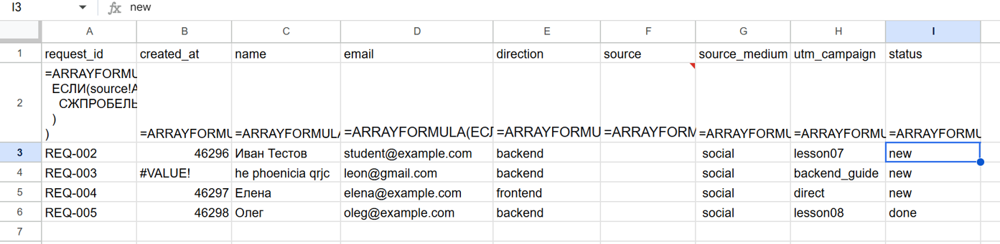
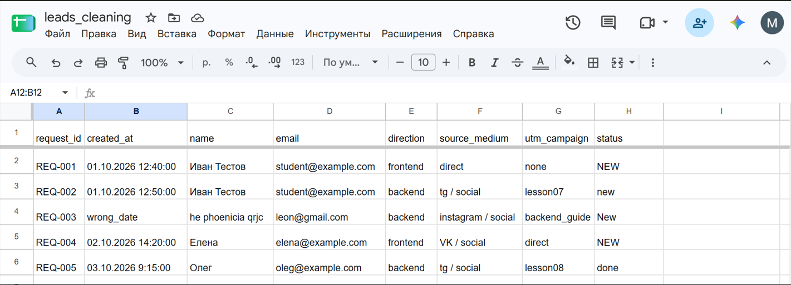
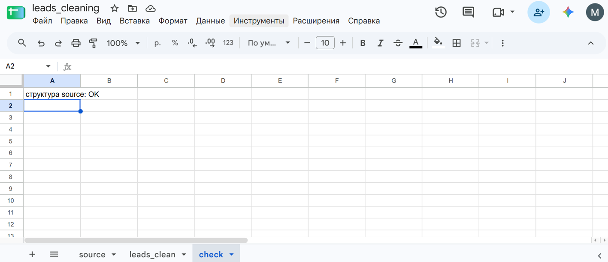

# Домашняя работа № 6 · Подготовка данных в Google Таблицах

**Дисциплина:** ОП.03 «Информационные технологии»

| Поле | Значение |
|---|---|
| Фамилия, имя, отчество | Гринько Мария |
| Группа | РПО-3 2025 |
| Номер работы | 6 |
| Тема работы | Повторяемая очистка выгрузки заявок в Google Таблицах |
| Дата сдачи | 30.10.2026 |

---

## 1. Лист source (исходные данные)

Я создал таблицу `leads_cleaning` и заполнил лист `source` исходными (грязными) данными для последующей очистки.

Ссылка на таблицу: [Вставьте вашу ссылку на таблицу]

**Скриншот (Лист source):**

## 2. Лист leads_clean (формулы очистки)

На листе `leads_clean` настроены формулы (ARRAYFORMULA, TRIM, LOWER, SPLIT), которые убирают лишние пробелы, делят `source_medium` на источник и канал и приводят текст к нижнему регистру.

**Скриншот (Лист leads_clean в режиме показа формул):**

## 3. Результат очистки

После применения формул данные на листе `leads_clean` стали чистыми: убраны лишние пробелы, источники и каналы разделены, статусы приведены к единому виду.

**Скриншот (Лист leads_clean с результатом):**

## 4. Лист check (проверка структуры)

На листе `check` формула сравнивает заголовки `source` с ожидаемыми и показывает «структура source: OK».

**Скриншот (Лист check):**

---

Не получилось: Все шаги выполнены успешно.

ИИ: использовал для написания формул очистки данных.