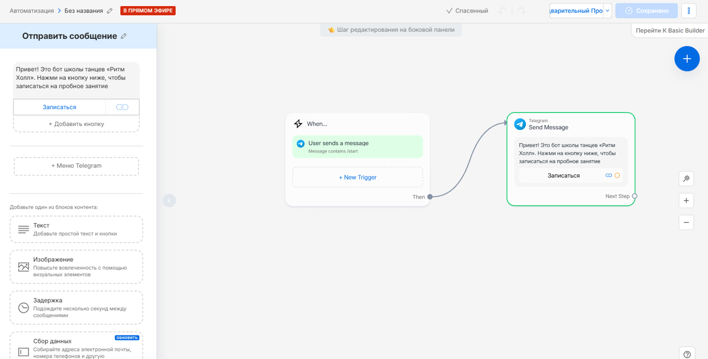
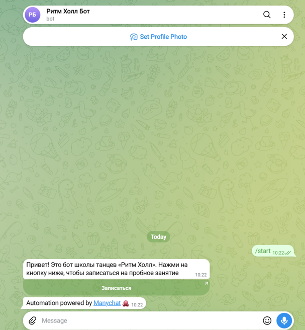
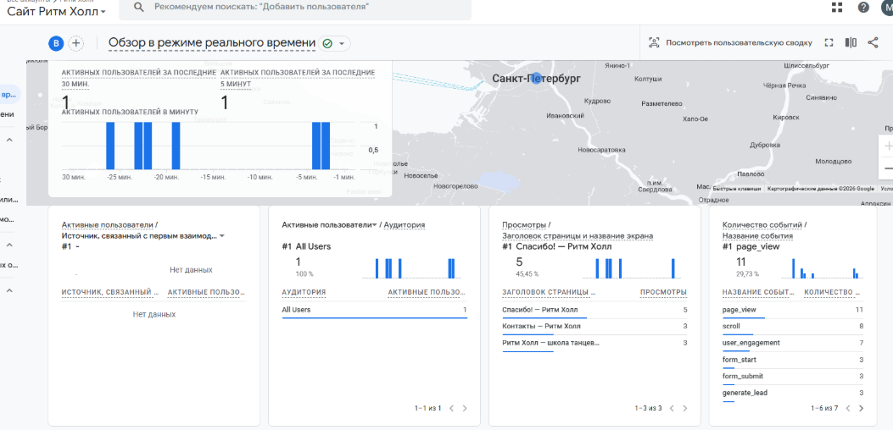
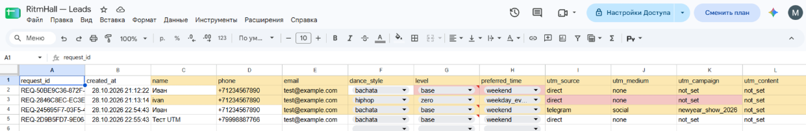

# Домашняя работа № 7 · Instagram → ManyChat → заявка

**Дисциплина:** ОП.03 «Информационные технологии»

| Поле | Значение |
|---|---|
| Фамилия, имя, отчество | Гринько Мария |
| Группа | РПО-3 2025 |
| Номер работы | 7 |
| Тема работы | Автоворонка из Instagram: комментарий → сообщение → сайт → заявка |
| Дата сдачи | 30.10.2026 |

---

## 1. Подключение и automation

Я подключил аккаунт к ManyChat на тарифе Free. Собрал automation: триггер на команду `/start`, публичный ответ и личное сообщение с кнопкой «Записаться» со ссылкой с UTM. Automation включена в режиме Live.

**Важное примечание:** Из-за технических ограничений доступа к сервисам Meta из РФ (ошибка `ERR_CONNECTION_ABORTED`), автоматизация была настроена для **Telegram** вместо Instagram. Логика работы полностью сохранена. **Скриншоты для этого отчета взяты из выполненной курсовой работы по проекту «Ритм Холл»**.

| Мои данные | Значение |
|---|---|
| Учебный аккаунт (Telegram) | @RitmHall_Test_bot |
| Публичный адрес сайта | https://tz-19-shkola-tancev-ritm-holl-liart.vercel.app/ |
| Measurement ID (`G-…`) | G-K0RDRQXZ9W |

**Скриншот (Сценарий в ManyChat):**

## 2. Тест цепочки

Я открыл своего бота в Telegram и отправил команду `/start`. В ответ пришло сообщение с кнопкой «Записаться», которая ведет на сайт с UTM-метками (`utm_source=telegram`). Я нажал на кнопку, перешел на сайт и отправил тестовую заявку через форму.

**Скриншот (Диалог с ботом):**

## 3. Результат

В GA4 пришли `page_view` и `generate_lead`. В листе `leads` появилась строка с метками `telegram` / `social` / `newyear_show_2026` и статусом `new`.

`request_id` заявки: `REQ-245695F7-03F5-4...` (из вашей таблицы)

**Скриншот (Событие в GA4):**

**Скриншот (Строка заявки в таблице):**

---

Не получилось: Из-за блокировок Meta интеграция с Instagram была заменена на Telegram (с сохранением всей логики и UTM-меток).

ИИ: использовал для генерации текста сообщения и настройки UTM-ссылки.